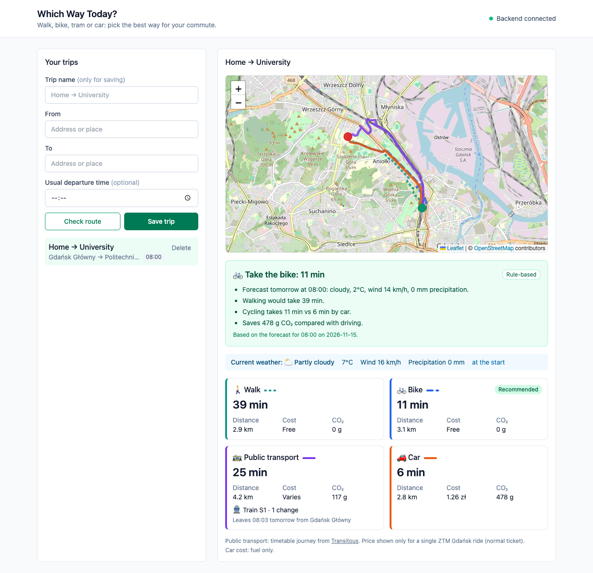
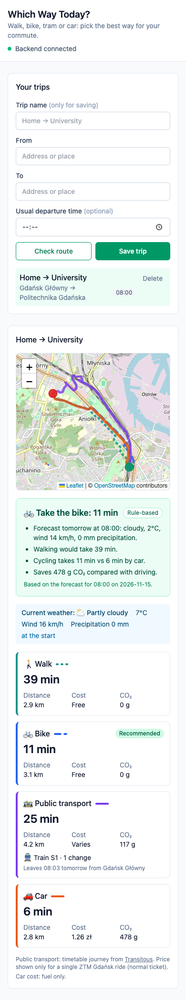

# Which Way Today? — Smart Commute Planner

Save your usual trips, then see at a glance whether to **walk, bike, take public
transport or drive** today: time, cost and CO₂ for each, plus a recommendation based on
the weather forecast for when you actually leave.

Built as an MVP for the Xelerit Winter Internship recruitment task (transport theme).



<details>
<summary>Phone view</summary>



</details>

## Why

Most route planners answer "how do I get there?". The daily commuter's question is
different: *"Given today's weather, which way should I go?"* A 3 km trip is a great
bike ride on a dry morning and a miserable one in sleet. This app puts the trade-off
(time vs cost vs CO₂ vs weather) on one screen for trips you make every day.

## Features

- **Check a route without saving it.** Enter From/To (and optionally a time), press
  *Check route*, and get the same map, recommendation and comparison. *Save this trip*
  keeps it afterwards, reusing the looked-up coordinates.
- **Saved trips.** Name, origin, destination and an optional usual departure time.
  Addresses are geocoded once when a trip is saved; you see whether an address wasn't
  found or the lookup service is temporarily down.
- **Four-way comparison.** Walk, bike and car use real street routes (OSRM). Public
  transport is a real timetable journey ([Transitous](https://transitous.org/)) for your
  next usual departure: buses, trams and trains, e.g. "🚶 3 min → 🚋 Tram 6 · 9 min →
  🚶 9 min, leaves 08:04", or "🚆 Train EIP · 2 h 29 min" for Gdańsk → Warsaw (journeys
  with more than 4 legs are summarised, e.g. "🚆 Train IC · 1 change"). The time is
  door to door from your departure time, including any wait for the first vehicle.
  Each mode shows time, distance, cost and CO₂, with its route drawn on the map.
- **Weather-aware recommendation.** Uses the hourly forecast for your next departure
  ("Forecast tomorrow at 08:00: …"), or current weather if no time is set. Deterministic
  rules rule out unsuitable modes (too long, too wet, too windy, icy) and pick the
  greenest reasonable one.
- **Optional AI.** With an OpenAI key, the model chooses among the *suitable* modes and
  explains why. Without a key, or if the AI fails, the rule-based answer is used: the app
  never depends on it.
- **Honest numbers.** Anything not from a live route or timetable (a mode whose
  upstream call failed or found nothing) is marked `~` / *Estimate*. Public transport
  shows a price only when it's known (a single ZTM Gdańsk ride); otherwise "Varies".
- **Works on phones.** Single-column layout; picking a trip scrolls its map and
  comparison into view.

## Quick start (Docker, zero config)

```bash
docker compose up --build
```

- App: <http://localhost:5173>
- API: <http://localhost:8000> (interactive docs at `/docs`)

No `.env` and no API key needed. Optional settings (shell env or a root `.env`, see
[`.env.example`](.env.example)):

| Variable | Default | Purpose |
|---|---|---|
| `BACKEND_PORT` / `FRONTEND_PORT` | `8000` / `5173` | Host ports, e.g. if 8000 is taken. The frontend's API URL and the backend's CORS origins are derived from them. |
| `OPENAI_API_KEY` | *(unset)* | Enables AI recommendations; rule-based without it. |
| `OPENAI_MODEL` | `gpt-4o-mini` | Model for recommendations. If it's retired, the app silently uses the rules. |

```bash
BACKEND_PORT=8010 FRONTEND_PORT=5180 docker compose up --build   # other ports
docker compose down -v                                           # stop and wipe the database
scripts/docker-smoke.sh                                          # end-to-end Docker check (ports 8010/5180, cleans up after itself)
```

Trips are stored in SQLite on a named volume (`db-data`), so they survive restarts.
The Docker setup assumes the browser runs on the same machine (`localhost`).

## Local development

Requires Python 3.12 and Node 22 (≥ 22.12) or 24. Run each block from the repo root.

```bash
# Backend: http://localhost:8000
cd backend
python3.12 -m venv .venv && source .venv/bin/activate
pip install -r requirements-dev.txt
uvicorn app.main:app --reload
pytest                      # 185 tests
ruff check . && ruff format .
```

```bash
# Frontend: http://localhost:5173 (talks to the backend on :8000 by default)
cd frontend
npm ci
npm run dev
npm test                    # 127 tests (Vitest + Testing Library)
npm run lint && npm run build
npm run format              # prettier (pinned); format:check to verify
```

## Architecture

```
frontend/  React 19 + Vite + TypeScript, TanStack Query (server state), Tailwind,
           Leaflet (react-leaflet). Served by nginx in Docker.
              │  REST / JSON (VITE_API_URL)
backend/   FastAPI + SQLModel + SQLite
           routers/       HTTP only: status codes, request/response models
           services/      business logic: comparison, recommendation, geocoding
           repositories/  database access (SQLModel)
           clients/       external APIs: Nominatim, OSRM, Open-Meteo, OpenAI
```

Routers never touch the database session; services never import FastAPI, so business
logic is unit-tested without HTTP. Every external call goes through `app/clients/*`
with a short timeout and returns a typed result or `None`. The one exception is
Nominatim, which raises a dedicated error on outages so the API can tell "address not
found" (404) from "geocoding unavailable" (503).

### API

| Method & path | Purpose |
|---|---|
| `GET /health` | Liveness (no DB or upstream dependency) |
| `GET/POST /trips`, `GET/PUT/DELETE /trips/{id}` | Saved trips (coordinates are stored with the trip) |
| `GET /geocode?q=` | Address → coordinates. `404` not found, `503` geocoding unavailable |
| `GET /trips/{id}/comparison` | Four modes with time, distance, cost, CO₂, `is_estimate`, route geometry, and current weather. Always `200` for an existing trip |
| `GET /routes/comparison`, `GET /routes/recommendation` | Same as the two above for a route that isn't saved: query params `origin_lat`, `origin_lon`, `destination_lat`, `destination_lon`, optional `departure_time` (`HH:MM`). `trip_id` is `null`; nothing is written |
| `GET /trips/{id}/recommendation` | `source: "ai" \| "rules"`, recommended mode, headline, reasons, and the weather used (forecast or current). Always `200` for an existing trip |

## Key decisions and trade-offs

- **Fail soft, per piece.** The comparison runs its routing and weather calls in
  parallel under one 6 s deadline. A failed or late call degrades *that mode* to an
  estimate (straight-line distance × 1.3 at a typical speed) instead of failing the
  request. Free public APIs are slow or rate-limited sometimes; the app should still
  answer.
- **Geocode once, on save.** Nominatim allows 1 request/s and asks clients to cache. The
  frontend geocodes when a trip is saved and stores the coordinates, so comparisons
  never geocode again. The client also throttles to 1 req/s and caches successes.
- **Rules first, AI second.** The rules decide which modes are *unsuitable* in this
  weather; the AI may only choose among the rest, and the headline is built from the
  chosen mode server-side. The AI can improve the explanation but can't make the advice
  unsafe or contradictory, and only numbers and weather are sent to it, never trip
  names or addresses.
- **One comparison per trip view.** `/comparison` and `/recommendation` are requested
  together; they share a single computation (60 s, keyed by trip id *and* coordinates),
  so the recommendation's numbers always match the cards and upstream calls are halved.
- **Separate endpoints for comparison and recommendation,** so a slow AI call never
  delays the comparison cards.
- **Docker that can't drift.** Compose derives the frontend's build-time API URL and the
  backend's CORS origins from the two host ports. Backend dependencies are pinned to the
  versions the tests run against.
- **Deliberately not built:** user accounts, eco-points (dropped as low value), and
  multimodal trips (see limitations).

## Public APIs used

All free and keyless except the optional OpenAI one.

| API | Used for | Usage-policy handling |
|---|---|---|
| [Nominatim](https://nominatim.org/) (OpenStreetMap) | Geocoding | Descriptive User-Agent, 1 request/s throttle, cache |
| [OSRM demo server](https://project-osrm.org/) | Car routes | Short timeouts, fallback to estimates |
| [FOSSGIS OSRM](https://routing.openstreetmap.de/) | Walking and cycling routes (the demo server only serves car) | Short timeouts, fallback to estimates |
| [Transitous](https://transitous.org/) | Public transport journeys (timetables) | Descriptive User-Agent, one request per trip comparison (shared, cached), visible [data-sources](https://transitous.org/sources/) link; falls back to an estimate |
| [Open-Meteo](https://open-meteo.com/) | Current weather and hourly forecast | Short timeouts; recommendation works without weather |
| [OpenStreetMap tiles](https://operations.osmfoundation.org/policies/tiles/) | Map background | Visible attribution |
| OpenAI Chat Completions *(optional)* | Recommendation wording | Off without a key; any failure falls back to rules |

## Assumptions and known limitations

- **Public transport fares:** a price is shown only for a single ride with ZTM Gdańsk
  (**4.80 PLN**, normal single ticket; reduced fares not modelled). Journeys with a change
  or other operators (PolRegio, PKP Intercity…) show "Varies".
- **SKM Trójmiasto is missing from Transitous's data,** so some Tricity journeys use
  PolRegio or Intercity trains or buses instead. Within Gdańsk, trams and buses cover it.
- **Transit time includes the wait** for the first departure, so it's comparable with
  driving; the card also says when the journey leaves (e.g. "Leaves 09:02").
- **Fallback estimate:** if Transitous fails or finds nothing, public transport is
  estimated from the car-route distance at 20 km/h plus 8 min, and marked *Estimate*.
- **Factors:** car cost is fuel only (~0.45 PLN/km); CO₂ uses typical averages per
  passenger-km (car 170 g, bus 70, tram 40, rail 35). All are documented constants in
  `backend/app/services/comparison_service.py`.
- **No bike + transit combinations** (bike to the station, park & ride).
- **Forecast hour on DST weekends** can be off by an hour (Open-Meteo applies one UTC
  offset to the whole forecast).
- **No accounts:** everyone using an instance sees the same trips.
- **SQLite with `create_all`,** no migrations: changing an existing table needs a database
  reset (`docker compose down -v`).
- **The AI path has only been tested with mocked responses** (no key was available
  during development).

## Roadmap

1. **Traffic-aware car times** via TomTom Routing (optional key, OSRM fallback).
2. **"Best time to leave":** sample departures across a window and chart car vs transit
   (Transitous already returns several departures per request).
3. **Fares for multi-leg journeys** (ZTM time tickets, Tricity metropolitan tickets).
4. **SKM Trójmiasto,** if its timetable becomes available in Transitous.

## How this was built (Claude Code setup)

The project was built with [Claude Code](https://claude.com/claude-code), configured in
the repo so the setup is reviewable:

- **[`CLAUDE.md`](CLAUDE.md)** plus [`backend/CLAUDE.md`](backend/CLAUDE.md) and
  [`frontend/CLAUDE.md`](frontend/CLAUDE.md): architecture, commands and the
  non-negotiables (zero-config, no hard AI dependency, fallbacks for every external API,
  keep Dockerfiles in sync). [`AGENTS.md`](AGENTS.md) points other agents to them.
- **[`.claude/commands/feature.md`](.claude/commands/feature.md)** (`/feature`): the
  workflow used for every step: short plan (stop and ask on contract changes, new
  dependencies or tables), **failing tests first**, implement, run tests and linters,
  then review.
- **[`.claude/agents/code-reviewer.md`](.claude/agents/code-reviewer.md)**: a
  bug-hunting review subagent (edge cases, FE/BE contract mismatches, security, missing
  tests), run on each diff via `/review` or at the end of `/feature`. Each finding was
  fixed or explicitly dismissed with a reason. Real bugs it caught include: the OSRM demo
  server silently returning car routes for walking and cycling; SQLite reusing deleted
  trip ids, which could show an old trip's cached comparison; and a Docker persistence
  check that passed even without the volume.
- **[`.claude/settings.json`](.claude/settings.json)**: allow-listed `pytest`, `ruff`,
  `npm run …` and read-only git commands, and a post-edit hook that formats each file
  Claude writes with the project's pinned tools: `ruff format` plus safe lint fixes from
  `backend/.venv/bin/ruff` (unused imports are kept, since the code using them may come
  in the next edit), and `frontend/node_modules/.bin/prettier`. If those aren't
  installed yet (fresh clone), the hook skips instead of downloading anything.

Every feature is one conventional commit (`feat:`, `fix:`, …), so `git log` reads as the
build plan.
